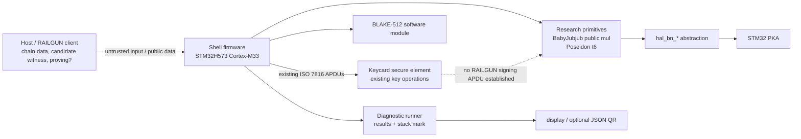
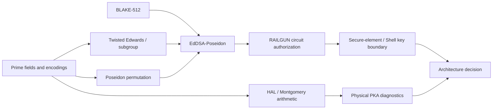
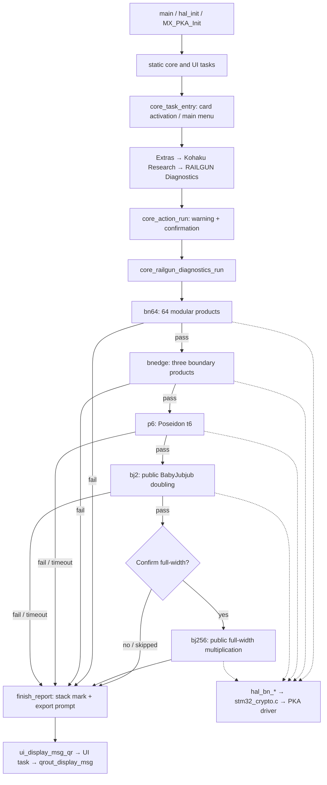

# RAILGUN cryptography on Keycard Shell: an engineering study guide

**Source snapshot:** `keycard-shell-railgun-upstream`, `research/railgun-upstream-v1`, commit `e9cccc7d354727d2d4675f10d4386e0d74c5e664`; compare the RAILGUN commit sequence after common ancestor `7e38e45` with `upstream/master`. **Research context:** `kohaku-key` at `710beec` when this guide was prepared. **Status:** experimental computation and diagnostics, with no physical Shell results in the material inspected and no secure RAILGUN wallet implementation.

This is a *study guide*, not a code audit or a promise of wallet security. Read the equations, trace the functions, and answer the exercises before relying on the model answers. Source references prefixed **S** are paths relative to the Shell repository at `e9cccc7`; **K** are relative to `kohaku-key`. A range such as `S:app/crypto/railgun_babyjubjub.c:185–269` names exact source lines. **[T]** means established mathematics or cryptography, **[P]** a protocol or reference-implementation claim, **[I]** an implementation observation, **[V]** a verified test result, and **[?]** an unmeasured or unresolved point. A passing host test proves only the properties that its assertions check.

## Executive architecture map



The solid computational path is in the PR. The dashed relationship is *absent*: the diagnostic never asks Keycard to derive, hold, or sign with a RAILGUN spending key. The firmware source list includes BabyJubjub, Poseidon, and BLAKE-512; the firmware diagnostic invokes modular multiplication, Poseidon, and public BabyJubjub multiplication. BLAKE-512 is covered by native tests and could be removed from a linked image if unused. `S:app/core/core_railgun_diagnostics.c:265–435`; `S:app/crypto/railgun_babyjubjub.h:1–34`; `S:app/crypto/railgun_poseidon_t6.h:1–24`; `S:tests/CMakeLists.txt:329–340`.

### Five claims to keep separate

| Class | What one may say | Evidence boundary |
|---|---|---|
| [T] Mathematics | Field operations and twisted Edwards group laws are well-defined for valid inputs. | The theorem does not validate this C code or silicon. |
| [P] RAILGUN | The protocol uses private notes, commitments, nullifiers, Merkle membership, and ZK circuit constraints. | Check the specific version of the circuits and SDK; Ethereum account signing is a separate operation. [R1][R2] |
| [I] This branch | It adds three crypto modules, a HAL-backed public point API, a diagnostic menu, and JSON QR reporting. | Trace source cited below. |
| [V] Host | The selected native binaries passed on the preparation machine under ASan/UBSan. | The host HAL computes with software bignums, not physical PKA. `S:tests/host/hal_pka_host.c`; `S:tests/README.md:1–43`. |
| [?] Device | PKA arithmetic, latency, stack margin, QR scanning, and timeout behavior remain to be measured on a Shell. | No physical result is supplied by this branch. |

### Read the code in this order

The list is a practical path through every source family needed to reconstruct this experiment; read the cited external circuit/reference sources after the C flow is clear.

1. `S:AGENTS.md`, `S:CLAUDE.md`, `S:tests/README.md`: repository constraints and host/target split; note that some README coverage prose is older than the current tests.
2. `S:app/hal.h:165–179`, `S:app/crypto/bignum.h`, `S:app/crypto/bignum.c`: byte-oriented modular interface and the internal big-number representation.
3. `S:tests/host/hal_pka_host.c:473–681`, `S:stm32/Core/Src/stm32_crypto.c:334–598`, `S:stm32/Drivers/STM32H5xx_HAL_Driver/Src/stm32h5xx_hal_pka.c:2133–2317`: software test seam versus target PKA modes, byte/word conversion and polling.
4. `S:app/crypto/railgun_babyjubjub.h:9–34`, then `S:app/crypto/railgun_babyjubjub.c:18–281`: field modulus, input contract, curve check, projective formula, scalar loop.
5. `S:app/crypto/railgun_poseidon_t6.h`, `S:app/crypto/railgun_poseidon_t6.c:7–123`, `S:app/crypto/railgun_poseidon_t6_constants.h`: exact lane order, rounds and constants.
6. `S:app/crypto/railgun_blake512.h`, `S:app/crypto/railgun_blake512.c:19–283`: `init → update → compress → final`.
7. `S:tests/test_railgun_babyjubjub.c`, `S:tests/test_railgun_poseidon.c`, `S:tests/test_railgun_blake512.c`, `S:tests/test_hal_pka.c`, `S:tests/CMakeLists.txt`: read every assertion and identify whether the implementation under test is app C or a host stand in.
8. `S:app/core/core_railgun_diagnostics.h`, `S:app/core/core_railgun_diagnostics.c:16–453`: each benchmark input, expected byte array, timer, status and JSON field.
9. `S:app/tasks/core_task.c:14–31,126–159`, `S:app/ui/menu.c:101–129`, `S:app/ui/english.c:359–362`, `S:app/ui/i18n.h`: entry path and what the user is actually told.
10. `S:app/ui/ui.c:82–89`, `S:app/ui/ui_internal.h:209–249`, `S:app/tasks/ui_task.c:32–125`, `S:app/qrcode/qrout.c:10–277`, `S:app/qrcode/qrcodegen.c`: outbound QR command, task notification and encoder.
11. `S:app/main.c:9–46`, `S:app/common.h:52–67`, `S:app/FreeRTOSConfig.h`: task stacks, priorities, static allocation and scheduling.
12. `S:bootloader/bootloader.c:14–51`, `S:docs/FLASHMAP.md`, `S:tools/firmware-sign.py`, `S:CMakeLists.txt`: boot/image signing, flash layout, source inclusion and revision stamping.
13. RAILGUN V2 JoinSplit/nullifier/Merkle circuits [R2][R21][R22], engine sign/prove path [R13][R14][R25], EIP-2494 [R6], iden3 Poseidon/EdDSA [R9][R11][R12], and ST PKA manual [R15]. Compare versions explicitly.



## Part 1 — The big picture

### 1.1 Ethereum account versus RAILGUN private account

An Ethereum externally owned account has a secp256k1 private key and public address; a transaction signature authorizes an EVM transaction and pays gas. A RAILGUN private balance is represented by encrypted notes and commitments in its privacy system. A RAILGUN spending credential authorizes spending those notes in the private circuit; viewing material supports finding/decrypting relevant notes. These are distinct credentials with distinct encodings and threat boundaries. A Keycard ECDSA signature over an Ethereum transaction cannot by itself satisfy a BabyJubjub EdDSA-Poseidon constraint. [R1][R2][R3] `K:docs/V3-PROPOSAL.md:10–34` correctly treats RAILGUN as a separate research track.

Think of the data flow in two stages. To *receive*, a wallet determines note data, encrypts information for the recipient, and places a commitment on-chain. A commitment hides the underlying note values while binding them cryptographically. To *spend*, the prover privately supplies note secrets and Merkle authentication paths. The public statement includes an accepted Merkle root, output commitments, nullifiers, and bound transaction data; the circuit checks that the input notes exist, their owner can authorize the spend, and value rules hold. A nullifier marks a note as spent without revealing which commitment it corresponds to. Merkle roots commit to a set of leaves; the witness path proves inclusion by hashing siblings in order. The exact hash functions and field packing are version-specific, so inspect the circuit rather than using these generic words as a byte-level recipe. [R2][R4]

A zero-knowledge proof establishes the circuit relation without publishing the private witness. It does *not* magically hide witness data from the machine that constructs the proof. If the host builds a witness from private keys, plaintext notes, or decrypted secrets, a compromised host may read them. Proof generation and spending authorization are separate: one may outsource some proof computation only after specifying exactly what private values that helper sees, how the final public statement is bound to the user's intent, and where the authorization signature is made. A hardware wallet can isolate an authorization key and give the user a trusted display, but that does not automatically isolate note discovery or witness construction. [R2] `K:docs/V4-KEYCARD-SHELL-ARCHITECTURE-DRAFT.md:52–94` discusses this boundary for a *different* Privacy Pools experiment; it is not RAILGUN evidence.

### 1.2 The trust and threat model

Consider five adversarial surfaces: malicious host input; compromised Shell firmware; extraction from Shell RAM, debug or side channels; a malicious or replaced card; and tampered chain/relay data. A design must decide which component checks amounts, recipients, chain IDs, Merkle roots, contract addresses, fees, and proof-bound data before approval. If a private spending scalar never leaves a secure element, the Shell may perform public arithmetic without possessing it. If the scalar is exported to Shell RAM, Shell firmware, its update path, physical access, and any DMA/interrupt exposure become part of the secret's trusted computing base. No C implementation of arithmetic can undo that boundary change. A secure-element APDU that merely signs an Ethereum digest is insufficient unless the RAILGUN circuit accepts the resulting authorization; the cited Keycard `SIGN` page lists `P2=0x00` secp256k1 ECDSA and, since applet 4.0, `P2=0x03` BIP-340 Schnorr, but no BabyJubjub EdDSA-Poseidon capability. [R3] `S:AGENTS.md` prohibits inventing APDUs.

**Possible future architecture, conditional:** Keycard might retain a suitably derived RAILGUN spending key and implement the required authorization primitive; Shell could compute public field operations, display a review, and exchange bounded data; a host or another prover could perform heavy proving under an explicit witness-sharing policy. This would require a documented Keycard applet/interface change, derivation and recovery design, input validation, constant-time secret arithmetic, display binding, and physical measurement. The PR decides none of those. The experiment answers a narrower question: *can this MCU/HAL perform useful compatible computations with acceptable device cost?*

### 1.3 A concrete V2 JoinSplit reading

The inspected RAILGUN **V2** JoinSplit circuit makes `merkleRoot`, `boundParamsHash`, input nullifiers, and output commitments public. Its witness includes a BabyJubjub spending public key and EdDSA-Poseidon signature, nullifying key, input note randomness/value/leaf index/Merkle siblings, and output note data. The circuit hashes its public signals for signature authorization; derives a master public key from spending-public-key coordinates and nullifying key; derives each input note public key from that master key and note randomness; checks note commitments and Merkle inclusion; derives each nullifier as `Poseidon(nullifyingKey,leafIndex)`; checks output commitments and balances input/output value for the constrained token. This is a more useful mental model than “the card signs a private transaction”: the signature, witness and proof have distinct roles and data. [R2][R21][R22]

The inspected engine derives spending and viewing nodes from separate hardened paths (`m/44'/1984'/0'/0'/index'` and `m/420'/1984'/0'/0'/index'` in the current source), builds note data and paths, asks the wallet to sign public inputs, and only then calls the prover with private inputs. The viewing key supports scanning/decryption and is therefore privacy-sensitive even though it cannot spend. These are **versioned implementation facts**, not a proposal to reuse Keycard's Ethereum derivation path. Current engine code also has V3 branches; the cited hand-written JoinSplit is specifically V2, so do not project its exact wire format onto every RAILGUN version. [R13][R14][R23][R25]

## Part 2 — Keycard and Shell hardware

### 2.1 Components and security boundary

A JavaCard secure element executes applets inside a chip designed to keep key material within its security boundary. The host speaks to applets through APDUs (command and response byte sequences); the physical Shell provides smartcard transport and UI. An APDU is an interface, not proof that a particular key type or algorithm is supported. The cited Keycard `SIGN` page says the applet supports `P2=0x00` secp256k1 ECDSA and, since 4.0, `P2=0x03` BIP-340 Schnorr; neither is BabyJubjub EdDSA-Poseidon. Any proposal for BabyJubjub EdDSA would need a separately specified, reviewed applet command or a different custody design. [R3][R5] `S:app/iso7816/smartcard.c`; `S:app/keycard/`; `S:AGENTS.md:166–174`.

A command APDU has a class byte (`CLA`), instruction byte (`INS`), parameters (`P1`,`P2`), optional data/length, and an optional expected response length; the response carries data and status words. For example, the *existing* Keycard `SIGN` reference describes a 32-byte hash and derivation path, requires an opened secure channel and verified PIN, and lists ECDSA and applet-4.0 Schnorr choices. It does not describe BabyJubjub EdDSA-Poseidon. This illustrates why a proposal cannot simply label a new byte sequence a “RAILGUN APDU.” [R3][R5][R28] `S:AGENTS.md:166–174`.

The Shell targets STM32H573VITX, a Cortex-M33 MCU with 2 MiB flash and 640 KiB RAM per this repository's development guide. It has a PKA, RNG, HASH, and AES peripherals. Cortex-M33 can execute ordinary C arithmetic; the PKA accelerates the modular operations exposed by the HAL. This is not a generic BabyJubjub or Poseidon engine: modular additions, multiplications, and inversions in the Poseidon and projective formulas cross the `hal_bn_*` boundary, which has setup and polling overhead. `S:AGENTS.md:6–24`; `S:app/crypto/railgun_poseidon_t6.c:34–113`; `S:app/crypto/railgun_babyjubjub.c:42–96`.

Shell firmware uses FreeRTOS static allocation; the repository forbids `malloc` and uses fixed globals, stack, and static pools. The flash map allocates each 1 MiB bank as 32 KiB write-protected bootloader, 608 KiB application, and 384 KiB data. The PR author reports an unsigned ELF with 642,576 bytes of static data/BSS and 12,784 bytes of unallocated static RAM at that build; those figures were not independently reproduced here and are not measured runtime stack headroom. `S:docs/FLASHMAP.md:13–25`; [R8]. The app's task split matters: the core task runs the diagnostic while UI interaction is mediated through the UI task. “640 KiB RAM” is device capacity, not available diagnostic stack. A high-water mark gives the *minimum remaining words observed so far in that task*, and conversion to bytes multiplies by `sizeof(StackType_t)`; it is not a full memory profile, a guarantee against future inputs, or a peak stack trace for another task. `S:AGENTS.md:26–61`; `S:app/core/core_railgun_diagnostics.c:212–217`; `S:app/FreeRTOSConfig.h`.

Firmware authenticity and boot behavior must be discussed at the level actually implemented by Shell: its bootloader, image signing workflow, flash map, and update checks, not as a blanket claim that all firmware is immutable. A build artifact being signed proves a build step, while secure boot requires a verified boot path, protected trust anchors, and a threat model for rollback and debug access. Examine `S:bootloader/`, `S:docs/FLASHMAP.md`, and the release build rules before making a device security claim. **[?]** This study does not treat the present diagnostic build as proof of a production secure-boot configuration.

| Work item | Keycard secure element | Shell | Host / other prover |
|---|---|---|---|
| Existing Ethereum secp256k1 authorization | Supported through documented Keycard operations [R3] | Transport, review, and orchestration | Prepare/broadcast transaction |
| RAILGUN BabyJubjub private signing | No documented current Keycard API established here | No signing in this PR; secret use would change trust model | Software can compute it, exposing key in its trust domain |
| Public BabyJubjub multiplication / Poseidon | Constrained by applet API, memory, and performance | Experimental HAL-backed code exists | Reference computation and testing |
| BLAKE-512 | No current APDU established | C implementation compiled; native tests | Reference implementation |
| Merkle witness / proof generation | Likely beyond present applet interface; measure rather than assume | Unimplemented and unmeasured | Existing RAILGUN client/prover path; private witness exposure must be stated |

### 2.2 A design review question

If a proposed flow says “derive the spending scalar on Keycard, then send it to Shell for EdDSA,” ask: *what security guarantee is being sought?* The key is then in ordinary MCU memory, and its lifetime, clearing, firmware trust, DMA, interrupt, debugging, physical access, and side channels all become relevant. If the key remains on-card, ask what exact APDU computes the protocol-required signature and how the card checks the message being signed. The present source has no such APDU and no end-to-end RAILGUN key lifecycle.

## Part 3 — Cryptographic foundations

### 3.1 Arithmetic before 256-bit arithmetic

For a prime `p`, the field `F_p` contains `0,...,p−1`; operations reduce modulo `p`. With `p=17`, `15+7=22≡5`, `3−8=−5≡12`, and `5×7=35≡1`. Thus `5^{-1}=7` because `5×7≡1`. Division by nonzero `b` means multiplying by `b^{-1}`. Zero has no inverse. The “canonical” integer representative is the unique member of `0,...,p−1`; byte strings at or above `p` need either explicit rejection or a documented reduction rule. Reducing where a protocol expects rejection can create alternate encodings of the same mathematical value.

A 256-bit integer is just 32 bytes plus an agreed byte order. `0x0102` is bytes `01 02` in big-endian and `02 01` in little-endian. The RAILGUN module APIs pass 32-byte *big-endian* field elements to `hal_bn_*`; BabyJubjub converts them into `bignum256` with `bn_read_be` and writes them with `bn_write_be`. Its curve point API rejects `x≥Fr` or `y≥Fr`; Poseidon instead reduces each public input modulo `Fr` in a repeated-subtraction loop. The synthetic signing test explicitly packs a small message in little-endian for BLAKE nonce hashing and big-endian for Poseidon field input. Mixing those conventions changes a signature. `S:app/crypto/railgun_babyjubjub.c:42–59,185–214`; `S:app/crypto/railgun_poseidon_t6.c:17–32,64–77`; `S:tests/test_railgun_babyjubjub.c:760–790`.

### 3.2 BN254 has two different large primes

The code's modulus is BN254's scalar field `Fr` (also the coordinate field of BabyJubjub):

```text
Fr = 0x30644e72e131a029b85045b68181585d2833e84879b9709143e1f593f0000001
   = 21888242871839275222246405745257275088548364400416034343698204186575808495617
```

Do not confuse this with the BN254 base field `Fq` used for points on the pairing curve; their moduli are different. BabyJubjub is an Edwards curve *over `Fr`*. The modular HAL accepts the explicit modulus argument, which is why the modulus bytes matter at every call. [R6] `S:app/crypto/railgun_babyjubjub.c:18–23`; `S:app/crypto/railgun_poseidon_t6.c:10–15`; `S:app/core/core_railgun_diagnostics.c:16–18`.

For 256-bit inputs, addition may require a 257th carry bit and multiplication a 512-bit intermediate before reduction. Modular subtraction with `a<b` adds the modulus after the borrow; inversion must reject zero. The existing `bignum256` type is a storage/conversion vehicle here, not the field engine: the test source warns its direct modular routines assume moduli nearer 256 bits, while `Fr` is a 254-bit modulus. The explicit-modulus HAL avoids that mismatch. `S:tests/test_railgun_babyjubjub.c:66–90`; `S:app/crypto/railgun_babyjubjub.c:42–96`.

For nonzero `a∈F_p`, Fermat's theorem gives `a^{-1}=a^{p−2} mod p`; an implementation can instead use an extended Euclidean algorithm or PKA inversion. In the branch, field add/sub/mul/inv are thin wrappers around `hal_bn_add_mod`, `hal_bn_sub_mod`, `hal_bn_mul_mod`, and `hal_bn_inv_mod`, with serialization on either side. They propagate `HAL_FAIL`. The host substitutes software bignums; target PKA behavior is a separate question. `S:app/crypto/railgun_babyjubjub.c:33–97`; `S:tests/host/hal_pka_host.c`.

### 3.3 Montgomery multiplication

For an odd modulus `p`, choose a power of two `R=2^k>p` with `gcd(R,p)=1`. Represent `x` as `x̄=xR mod p`. A Montgomery product computes `MontMul(x̄,ȳ)=x̄ȳR^{-1} mod p = xyR mod p`, staying in Montgomery representation. Convert in with `MontMul(x,R² mod p)` and out with `MontMul(x̄,1)`. The point is to replace costly general division by shifts, masks, and multiplications by a precomputed `−p^{-1} mod R`; hardware can implement that efficiently. This representation must never leak into an API that promises ordinary canonical bytes.

A toy check with `p=17`, `R=32`, and `R^{-1}≡8`: `5̄=5·32 mod17=7`, `7̄=7·32 mod17=3`, `MontMul(7,3)=21·8 mod17=15=1̄`, and `MontMul(15,1)=1`. An ordinary modular product and a Montgomery product have different outputs unless operands and conversion are arranged correctly. The STM32 target HAL's setup/operation modes must be traced before assigning these steps to its driver; see Part 8.

### 3.4 Boundaries, timing, and leakage

Useful test boundaries are `0`, `1`, `p−1`, `p−2`, and the largest 256-bit input. In the actual branch `(Fr−1)²≡1`, `2(Fr−1)≡Fr−2`, and `0·(Fr−1)=0` are three target diagnostic vectors. These cover high limbs and reduction behaviors that `7×11=77` does not. `S:app/core/core_railgun_diagnostics.c:20–49,265–342`.

A function can be mathematically correct and still leak a secret through time, power, cache, branches, or fault behavior. The public BabyJubjub scalar loop skips leading zero bits and conditionally adds on set bits; Poseidon input reduction takes a data-dependent number of subtractions; an inversion may also be variable time. Such behavior is acceptable only after classifying the operands as genuinely public and guarding their path to the function. Secret signing would require a separate constant-time review, subgroup/point policy, key erasure, nonce correctness, and fault resistance. `S:app/crypto/railgun_babyjubjub.c:228–255`; `S:app/crypto/railgun_poseidon_t6.c:17–32`.

## Part 4 — BabyJubjub

### 4.1 The group, from equation to subgroup

BabyJubjub is the twisted Edwards curve over `Fr`

`168700·x² + y² = 1 + 168696·x²y² (mod Fr)`.

Its identity is `O=(0,1)`, and the negative of `(x,y)` is `(−x,y)`. For points where the denominators are nonzero, affine addition is

`x₃=(x₁y₂+y₁x₂)/(1+d x₁x₂y₁y₂)` and `y₃=(y₁y₂−a x₁x₂)/(1−d x₁x₂y₁y₂)`.

Scalar multiplication `[n]P` repeats this group operation; doubling is `P+P`. The full curve has order `8l` and a prime-order subgroup of order `l=2736030358979909402780800718157159386076813972158567259200215660948447373041`. The standard `Base8` lies in that subgroup. `Fr` determines coordinate arithmetic; `l` determines scalar arithmetic for signatures. They are different moduli. [R6]

The order-two point `T=(0,Fr−1)=(0,−1)` is on the curve: with `x=0`, both sides become `y²=1`. Its square under the group law is `T+T=(0,(−1)(−1))=(0,1)=O`. Consequently `[1]T=T`, `[2]T=O`, and any odd scalar returns `T`. Since `l` is odd, `[l]T=T≠O`: it is outside the prime subgroup. Checking only the curve equation therefore does not prove subgroup membership. A candidate subgroup check for a valid point is `[l]P=O`, plus protocol-specific rejection of the identity and any other forbidden encoding. Cofactor clearing `[8]P` has different semantics and cannot be substituted blindly for validation. [R6]

A miniature version uses `F₁₇`, `a=1`, `d=3` and `P=(1,0)`. It satisfies `x²+y²=1+3x²y²`; the affine denominators are 1 for the additions here. `2P=(0,16)`, `3P=(16,0)`, and `4P=(0,1)`. This shows that even an on-curve point can have small order; the large BabyJubjub field changes the numbers, not the issue.

### 4.2 Trace the exact C path

| Function | Input/output and work | What to inspect |
|---|---|---|
| `field_binary`, `field_add/sub/mul`, `field_inv` | Convert internal `bignum256` to 32-byte big-endian, invoke one `hal_bn_*` operation with `Fr`, convert back; propagate failure. | `S:app/crypto/railgun_babyjubjub.c:33–97` |
| `point_on_curve` | Compute `a x²+y²` and `1+d x²y²`; compare them. | It proves equation membership only. `S:app/crypto/railgun_babyjubjub.c:99–121` |
| `projective_add` | Use homogeneous `(X:Y:Z)` coordinates. Let `A=Z₁Z₂`, `B=A²`, `C=X₁X₂`, `D=Y₁Y₂`, `E=dCD`, `F=B−E`, `G=B+E`, `H=(X₁+Y₁)(X₂+Y₂)−C−D`, `J=D−aC`; output `(AFH,AGJ,FG)`, fail on zero `Z`. | No inversion per addition; field HAL calls dominate. `S:app/crypto/railgun_babyjubjub.c:123–167` |
| `projective_to_affine` | Reject `Z=0`, compute `Z⁻¹`, then `(X/Z,Y/Z)`. | One inversion after scalar loop. `S:app/crypto/railgun_babyjubjub.c:169–183` |
| `railgun_babyjubjub_public_mul_with_checkpoint` | Reject nulls and noncanonical coordinates; verify input on curve; initialize `O=(0,1,1)`; scan a 32-byte big-endian scalar MSB first, skip leading zero bits, double and conditionally add; convert back and recheck curve; serialize output. | Callback is once per scalar *byte*, not per bit or HAL call. No subgroup test. `S:app/crypto/railgun_babyjubjub.c:185–269` |
| `railgun_babyjubjub_public_mul` | Same routine with null checkpoint. | `S:app/crypto/railgun_babyjubjub.c:273–281` |

The projective formula can be checked against the affine one by setting `Z₁=Z₂=1`: `X₃/Z₃ = H/(1+E)` and `Y₃/Z₃ = J/(1−E)`. It avoids repeatedly inverting denominators, a major tradeoff when inversion is expensive. It still has a large call count: the source has 13 modular multiplications, three additions, and four subtractions per projective add, plus error checks. The method is not constant-time as a scalar multiplier because the loop branches on scalar bits and its leading zeros. `S:app/crypto/railgun_babyjubjub.c:138–166,228–255`.

The API header calls the scalar **public**, documents variable time and absence of subgroup enforcement, and requires distinct nonoverlapping outputs. Canonical `x,y<Fr` is checked by `memcmp` on their 32-byte big-endian encodings. The first on-curve check and final on-curve recheck do not add a subgroup check. For fixed diagnostic `Base8` this is a controlled public input; for attacker-supplied points in a secret-key protocol it would require a new validation and threat model. `S:app/crypto/railgun_babyjubjub.h:9–25`; `S:app/crypto/railgun_babyjubjub.c:202–218,258–267`.

### 4.3 The Daybreak finding and what the regression proves

The PR author reports that Daybreak Blue noticed this on-curve/subgroup gap, the limited original `7×11` PKA benchmark, and soft diagnostic deadlines. The same summary reports no identified path carrying Keycard secret material into these variable-time routines at that snapshot; that is a bounded source-flow observation, not a proof that future secret use would be safe. I could inspect the PR author's summary and the source follow-ups, but found no separate Daybreak-authored report or GitHub review on that PR; treat the attribution as reported, not independently authenticated. [R8]

Commit `e9cccc7` adds `test_firmware_public_mul_accepts_low_order_point`: it constructs `Fr−1` as `y`, calls the firmware public API with scalar 1 and checks that it returns `T`, then scalar 2 and checks that it returns `O`. This is a precise *behavior regression*. It does **not** reject low-order points, test every point of order dividing 8, exercise a private scalar, prove security for untrusted inputs, or execute physical PKA. The test's own comment says it does not endorse security-sensitive use. `S:tests/test_railgun_babyjubjub.c:893–937`; `git show e9cccc7`.

## Part 5 — Poseidon t6

### 5.1 Why this hash and what the parameters mean

A conventional byte hash such as SHA-512 spends many Boolean/bit operations inside an arithmetic circuit. Poseidon is designed as a field permutation that can be expressed with relatively few algebraic constraints. The exact function depends on field, state width, round count, S-box exponent, round constants, MDS matrix, input layout, and output selection. “Poseidon” alone is not an interoperable algorithm identifier. [R7]

Here **t6** means a six-element state over BN254 `Fr`. This one-call API puts five input field elements in lanes 1–5 and zero in lane 0, conventionally describing a rate of five and capacity of one for this invocation. It executes a 68-round permutation: eight full rounds (first four and last four), 60 partial rounds, exponent-5 S-box, and a dense `6×6` MDS matrix. It returns lane 0. This function has no streaming absorb/squeeze interface and must not be described as a general arbitrary-length sponge. `S:app/crypto/railgun_poseidon_t6.c:7–15,64–116`; [R9].

For one round, write the six lanes as vector `s`. First add six constants: `uᵢ=sᵢ+C[r,i] (mod Fr)`. Then apply `uᵢ←uᵢ⁵` to all lanes in a full round, or only lane 0 in a partial round. Then mix: `s'ᵢ=Σⱼ M[i,j]uⱼ (mod Fr)`. The matrix must be the exact compatible MDS matrix; replacing it with any invertible matrix changes every digest. The constants file contains `poseidon_t6_mds[6][6][32]` and `poseidon_t6_rc[68][6][32]` as big-endian field bytes, with a provenance comment identifying `kohaku-rs`/`poseidon-rust` `circom_t6`. The first MDS element is `M[0,0]=0x124666f80561ed5916f2f070b1bd248c6d53f44d273d956a0c87b917692a4d18`; the first round constant is `C[0,0]=0x1448614598e00f98e7ae7dea45fbd83bd968653ef8390cde2e86b706ad40c651`. Those concrete bytes fix the parameter set more clearly than a generic “Poseidon t6” label. The checked vectors establish selected outputs, not an exhaustive proof of how every constant was generated. `S:app/crypto/railgun_poseidon_t6_constants.h:1–11,60–68`.

### 5.2 One invocation, all the way to the HAL

`railgun_poseidon_t6_hash(inputs,out)` calls the checkpoint variant. That routine rejects null arguments, reduces each public 256-bit input modulo `Fr`, fills lanes 1–5, then executes the loop above. `reduce_input` does at most five subtractions for a 256-bit value because `⌊(2²⁵⁶−1)/Fr⌋=5`; its timing depends on the input. `add_into` uses a separate result buffer to avoid assuming HAL input/output aliasing. `sbox5` computes `x²`, `x⁴`, `x⁵` with three HAL modular multiplications. The MDS loop makes 36 more multiplications per round, each followed by modular addition. `S:app/crypto/railgun_poseidon_t6.c:17–123`.

The exact source-derived count is `68×36 + (8×6+60)×3 = 2,772` `hal_bn_mul_mod` calls and `68×(36+6)=2,856` modular-add calls per hash, excluding input reduction and lower-level Montgomery setup. That explains why hardware-call overhead may matter more than a simple “PKA is fast” claim. The actual latency is **[?]** until measured on the board.

The host suite compares `(1,2,3,4,5)` to `0dab9449e4a1398a15224c0b15a49d598b2174d305a316c918125f8feeb123c0`, plus a sequential-input case and signing-shaped challenges for message 0 and 1. It verifies `Fr→0`, `Fr+1→1`, and `2²⁵⁶−1→its canonical remainder`, and checks null arguments and first checkpoint abort. These tests use the host HAL stand in. `S:tests/test_railgun_poseidon.c:33–179`. The diagnostic uses the same `(1,2,3,4,5)` output as its physical comparison. `S:app/core/core_railgun_diagnostics.c:51–53,344–369`.

## Part 6 — Original BLAKE-512

BLAKE-512 here is the original SHA-3 finalist, **not** BLAKE2b and not SHA-512. In the circomlib-style EdDSA-Poseidon flow, it expands the 32-byte private seed and derives a deterministic nonce from the second half of that digest plus a little-endian message encoding. Poseidon hashes the signature challenge in the field; the two hashes have different jobs. [R10][R11] `S:tests/test_railgun_babyjubjub.c:702–797`.

`railgun_blake512` validates `(input,length,output)`, initializes a stack-local state, updates it, finalizes a 64-byte digest, and wipes the state with `memzero`. The 128-byte message block is parsed into 16 big-endian 64-bit words. The compression function initializes 16 working words from chaining state, salt, constants and bit counter; runs 16 rounds of eight `G` mixes (four column, four diagonal); then folds the result into the chaining state. `G` uses addition, XOR, and rotations by 32, 25, 16, and 11. `update` counts full 1024-bit blocks; `final` handles one or two padding blocks around byte position 111, appends a 128-bit bit length, and serializes eight 64-bit digest words. `S:app/crypto/railgun_blake512.c:19–32,105–158,161–283`.

The tests compare exact digests for the empty string and `abc`, a synthetic all-`0x01` seed, three nonce preimages, and patterned messages of lengths 1, 111, 112, 127, 128, 129, 255, 256, 257, and 1024 bytes. Those lengths specifically hit padding and compression boundaries. Null arguments are negative tests. This demonstrates native compatibility for those messages; it does not test physical stack use, timing, or a secret signing flow. `S:tests/test_railgun_blake512.c:15–154`. BLAKE-512 is listed among firmware sources but never invoked by `core_railgun_diagnostics_run`, which is why no BLAKE timing appears in the initial QR report. Linker garbage collection may omit the unused function from the final ELF. `S:CMakeLists.txt:192–194`; `S:app/core/core_railgun_diagnostics.c:265–435`.

## Part 7 — EdDSA-Poseidon and signing

A digital signature ties a secret scalar to a public key and message. In EdDSA variants, the signer deterministically derives an ephemeral nonce, computes a nonce point, hashes that point with the public key and message into a challenge, and forms a scalar response. Nonce reuse or bias can reveal a signing key; a “deterministic” label is meaningful only if the exact hash, encoding, domain and scalar reductions are correct. [R11]

The synthetic test follows this *reference-style* flow, using `Base8` and subgroup order `l`:

```text
h = BLAKE-512(seed)                  // 64 bytes; seed is fixed test data
s = LE(prune(h[0:32]))              // prune bit pattern, not a field operation
A = [s/8]Base8                       // s is divisible by 8
r = LE(BLAKE-512(h[32:64] || message_le_32)) mod l
R8 = [r]Base8
c = Poseidon_t6(R8.x, R8.y, A.x, A.y, message_field)
S = (r + c*s) mod l
signature = (R8,S)
```

Here `message_le_32` is a 32-byte little-endian nonce preimage, while `message_field` is a big-endian field element at the C API. The test uses 32 bytes of `0x01` and messages 0, 1, and 12345, then compares expected derived scalar, public point, nonce, `R8`, and `S` values. The separate BLAKE suite checks the synthetic seed digest. `S:tests/test_railgun_babyjubjub.c:559–799`; [R11].

Any security-sensitive verifier needs a specified encoding and point-validation policy, the same challenge, and the correct group equation; do not infer full subgroup rejection from the cited circomlib verifier. For this circomlib convention the equation is **`[S]Base8 = R8 + [8c]A`**, because `A=[s/8]Base8` whereas `S` uses `s`. Omitting the factor 8 gives the wrong scheme. The reference verifier also checks `S<l`. [R11][R12]

RAILGUN V2's JoinSplit circuit verifies a private EdDSA-Poseidon signature over a hash of its public inputs and constrains note/nullifier/Merkle/balance relations. Its engine constructs the private inputs and calls signing before asking the prover to produce a Groth16 proof. This is the protocol reason the scheme matters; a normal Ethereum transaction signature is different. The engine uses a RAILGUN fork of circomlibjs, so exact cross-version compatibility should be checked against the pinned engine dependency before claiming full interoperability. [R2][R13][R14]

**The branch has no secure on-device signing function.** The scalar helpers and signature assembly live in `tests/test_railgun_babyjubjub.c`; the firmware API is explicitly public-only. Before any real spending key could be used, a design would need key derivation/recovery and ownership, a secure authorization interface, constant-time secret scalar multiplication and scalar arithmetic, subgroup/identity policies, nonce review, message/transaction binding, clearing and side-channel/fault testing. None follows from matching synthetic signature fixtures. `S:app/crypto/railgun_babyjubjub.h:9–25`; `S:tests/test_railgun_babyjubjub.c:559–799`.

## Part 8 — STM32 PKA and HAL integration

### 8.1 Follow a modular multiplication

The cryptographic modules call the existing HAL interface with 32-byte big-endian operands and explicit modulus; they do not call PKA registers directly. BabyJubjub uses `field_binary → hal_bn_add_mod/sub_mod/mul_mod` or `field_inv → hal_bn_inv_mod`. Poseidon uses `add_into/sbox5/MDS loop → hal_bn_add_mod/mul_mod`. The STM32 target implementation is inherited upstream code, not a new PKA driver in this PR. `S:app/hal.h:165–179`; `S:app/crypto/railgun_babyjubjub.c:42–96`; `S:app/crypto/railgun_poseidon_t6.c:34–113`; `S:stm32/Core/Src/stm32_crypto.c:334–345,479–598`.

For `hal_bn_mul_mod(a,b,m,out)` the source sequence is:

```text
hal_bn_mul_mod(a,b,m,out)
  hal_bn_mul_r2(a,m,tmp)
    HAL_PKA_MontgomeryParam(m)       -> R² mod m / hardware parameter
    PKA_MODE_MONTGOMERY_MUL(a,R²)    -> tmp = aR mod m
  hal_bn_mul_mont(tmp,b,m,out)
    PKA_MODE_MONTGOMERY_MUL(tmp,b)   -> out = ab mod m
```

The hardware's Montgomery product divides by `R` modulo `m`, so `(aR)·b·R⁻¹=ab`. The first parameter computation and two multiplication modes are **three PKA operations per ordinary `hal_bn_mul_mod` call** in this path. There is no cached parameter for fixed `Fr` in the inspected function. Reusing it could be a performance hypothesis, but would require verifying PKA ownership, reentrancy, invalidation, and correctness before optimizing. `S:stm32/Core/Src/stm32_crypto.c:334–345,509–545`; [R15].

`_hal_pka_ari_set` writes operand bit length, modulus and operands into PKA RAM. The STM32 driver converts the 32-byte external big-endian order into least-significant 32-bit word first for PKA RAM, and converts results back. `hal_bn_add_mod`, `hal_bn_sub_mod`, and `hal_bn_inv_mod` select their respective PKA modes. This byte/word boundary is a reason the `Fr−1` hardware vectors matter: tiny operands leave almost all high words zero. `S:stm32/Core/Src/stm32_crypto.c:479–507,559–598`; `S:stm32/Drivers/STM32H5xx_HAL_Driver/Src/stm32h5xx_hal_pka.c:2133–2228`.

`PKA_Process` selects a mode, starts the peripheral, polls for completion, handles timeout and hardware error flags, then restores ready state. Its per-operation timeout is `PKA_TIMEOUT=500` ms in the inherited HAL; that is distinct from the diagnostic's many-second soft budget. A bad call returns `HAL_FAIL` up the cryptographic stack. `MX_PKA_Init` is called during `hal_init` before FreeRTOS tasks begin. Host tests bypass this register, RAM, clock and polling path entirely. `S:stm32/Core/Inc/stm32_internal.h:13–15`; `S:stm32/Drivers/STM32H5xx_HAL_Driver/Src/stm32h5xx_hal_pka.c:1603–1610,1987–2002,2262–2317`; `S:stm32/Core/Src/stm32.c:84–100`.

The PKA has modular arithmetic and supported ECC modes. BabyJubjub is an Edwards curve; this implementation composes its point formula from modular field operations rather than invoking the existing `hal_ec_point_multiply`, whose curve interface is for the firmware's other curve family. ST's reference manual says Edwards curves are not directly accelerated as a point operation by this PKA. `S:stm32/Core/Src/stm32_crypto.c:400–424`; [R15].

### 8.2 Original benchmark and the follow-up

The first diagnostic repeated `hal_bn_mul_mod(7,11,Fr)` 64 times, checked every result was 32-byte integer 77, then reported aggregate tick time. That measures a repeated small-operand path and can catch gross failure, but cannot exercise high-limb carry/reduction behavior. Commit `ab36627` adds a separately timed `bnedge` row with `(Fr−1)²→1`, `(Fr−1)·2→Fr−2`, and `0·(Fr−1)→0`. Algebraically, `Fr−1≡−1`, so `(-1)²=1` and `(-1)·2=−2≡Fr−2`. The explicit expected 32-byte arrays are in `S:app/core/core_railgun_diagnostics.c:20–49`; the `64` loop and boundary loop are `:265–342`. The change is a correctness probe, not proof of all PKA cases or a device result.

## Part 9 — Embedded firmware integration

The actual runtime path is:


Source map: `S:app/main.c:9–46`; `S:stm32/Core/Src/stm32.c:84–100`; `S:app/tasks/core_task.c:14–31,126–159`; `S:app/ui/menu.c:101–129`; `S:app/core/core_railgun_diagnostics.c:265–435`; `S:app/ui/ui.c:82–89`; `S:app/tasks/ui_task.c:32–80`; `S:app/qrcode/qrout.c:223–277`. The menu path is under `Extras` and excluded for `BITCOIN_ONLY`. The displayed warning says public vectors only: no keys, signing, or transactions. Normal core startup requires a present/activated Keycard before opening the menu, but this diagnostic's computation calls no Keycard operation. `S:app/ui/english.c:359–362`; `S:app/tasks/core_task.c:126–148`.

Core/UI communication uses global `g_ui_cmd` plus task notifications: core posts a UI command and waits, UI performs the dialog/QR work and reports completion. UI priority is 3, core 2, USB 1; FreeRTOS is preemptive with static task allocation and dynamic allocation disabled. The diagnostic's busy computation can be preempted by higher-priority work but has no in-loop cancel-key handling. `S:app/ui/ui_internal.h:209–249`; `S:app/tasks/ui_task.c:44–80,123–125`; `S:app/main.c:9–20`; `S:app/FreeRTOSConfig.h:48,65,75–77`.

The “soft deadline” callback compares elapsed FreeRTOS ticks to a budget at each Poseidon round or each scalar byte. It does not interrupt a PKA call, check every scalar bit, or service a user cancel event. Thus 120 s for Poseidon, 30 s for `[2]Base8`, and 180 s for full-width multiplication are thresholds checked cooperatively, not hard worst-case execution limits. The 64-call BN row and three boundary cases have no aggregate budget. The optional full-width run requires an extra user confirmation. A PKA failure, incorrect expected output, or callback failure stops later rows; `finish_report` still allows a partial export. `S:app/core/core_railgun_diagnostics.c:78–95,265–435`; `S:app/crypto/railgun_poseidon_t6.c:79–82`; `S:app/crypto/railgun_babyjubjub.c:228–231`.

The core stack is statically 2,048 `StackType_t` words (8,192 bytes on 32-bit ARM); UI has 6,000 words. The FreeRTOS high-water mark is minimum-ever unused stack for the core task up through report completion, converted from words to bytes. Previous core activity can affect it, and it is not a current free-RAM measurement or a full profile of nested frames. A detected stack overflow invokes a fail-stop hook that disables interrupts and loops forever; that behavior avoids continuing after detected corruption but does not recover a session. `S:app/main.c:9–20`; `S:app/core/core_railgun_diagnostics.c:142–154,212–217,438–453`; `S:app/common.h:52–67`.

The project has a firmware signature verification path: bootloader code hashes the firmware excluding its signature field and verifies secp256k1 against an embedded public key, switching/rebooting on failure. The CMake release pipeline signs an ELF through a script marked development-only, and CI generates test keys for reproduction artifacts. These are source-level facts about the image path, **not** a claim that the inspected research build has production keys, physical protection settings, rollback resistance, or a measured secure boot on a device. `S:bootloader/bootloader.c:14–51`; `S:CMakeLists.txt:367–383`; `S:tools/firmware-sign.py:1–44`; `S:.github/workflows/build.yml:52–75`; [R16]. FreeRTOS has TrustZone and per-task MPU support disabled, although startup configures broad global MPU regions; no RAILGUN secret isolation is established here. `S:app/FreeRTOSConfig.h:71–72`; `S:stm32/Core/Src/stm32.c:92`; `S:stm32/Core/Src/main.c:1086–1154`.

## Part 10 — Benchmarks and QR export

| Report key | Diagnostic input and pass criterion | Timing and stop behavior |
|---|---|---|
| `bn64` | 64 repeated `7×11 mod Fr`; every result must equal 77. | One aggregate tick window; early failure stops later rows. |
| `bnedge` | The three full-width results from Part 8 must exactly match fixed arrays. | Separate tick window; early failure stops later rows. |
| `p6` | Poseidon t6 on `(1,2,3,4,5)` must equal `0dab9449e4a1398a15224c0b15a49d598b2174d305a316c918125f8feeb123c0`. | One hash, soft 120 s limit. |
| `bj2` | `[2]Base8` must match stored `double_x,double_y`. | One public multiplication, soft 30 s limit. |
| `bj256` | With user consent, multiply Base8 by `0ba9f4de43d3c912590c6ab4f8e7f3c0c0229e25c7dd052203b928fcdc87dfba`; compare x=`234056d968baf183fe8d237d496d1c04188220cd33e8f8d14df9b84479736b20`, y=`2624393fad9b71c04b3b14d8ac45202dbb4eaff4c2d1350c9453fc08d18651fe`. | One public multiplication, soft 180 s limit; user decline yields `skipped`. |

These inputs, expected arrays, budget initialization and comparisons are `S:app/core/core_railgun_diagnostics.c:16–76,265–435`. `elapsed_ms` converts FreeRTOS tick difference using `portTICK_PERIOD_MS`; the configured tick rate is 1 kHz. Timed windows include HAL calls, comparisons and possible scheduling/interrupt effects, but stop before each result UI. They are single measurements, not PKA-only cycle counts or statistical distributions. A failed row may report its partial elapsed time. `S:app/core/core_railgun_diagnostics.c:97–100,275–301,312–337,351–367,380–400,413–435`; `S:app/FreeRTOSConfig.h:51`.

`report` starts zeroed: unreached rows are `not_run`. Status `timeout` is set only when the cooperative callback has marked the budget expired; a HAL failure or output mismatch otherwise becomes `fail`. `bj256` becomes `skipped` only after a passed `bj2` and a declined confirmation. The exported JSON uses `s` for status and `ms` for elapsed milliseconds; `ms` is `null` for `skipped` and `not_run`. It also includes schema version `v`, source revision `rev`, and `stack_free` in bytes. `S:app/core/core_railgun_diagnostics.c:161–263,265–435`.

**Illustrative only; these numbers are invented to show the schema, not measured device results:**

```json
{"v":1,"rev":"e9cccc7","bn64":{"s":"pass","ms":4},"bnedge":{"s":"pass","ms":1},"p6":{"s":"pass","ms":2500},"bj2":{"s":"pass","ms":900},"bj256":{"s":"skipped","ms":null},"stack_free":4096}
```

`RAILGUN_GIT_REV` is captured at CMake configure time from `git rev-parse --short=7 HEAD`, with `unknown` fallback. It can be stale if HEAD changes without reconfiguration. The C builder uses a fixed 320-byte stack buffer and bounded append functions. Those functions silently truncate if capacity is exhausted; the fixed schema normally has ample space, but no explicit final “complete JSON” check exists. `ui_display_msg_qr` passes the buffer through the UI task to `qrout_display_msg`; QR generation uses `qrcodegen_encodeText` with fixed buffers, low error correction and versions 1–21. An encode/display failure is not added to the benchmark JSON, and physical scan quality is **[?]**. The report is not signed/attested; `rev` is an intended source-revision label, not a measured firmware identity. `S:CMakeLists.txt:101–113`; `S:app/core/core_railgun_diagnostics.c:102–126,225–263`; `S:app/ui/ui.c:82–89`; `S:app/tasks/ui_task.c:78–80`; `S:app/qrcode/qrout.c:10–53,223–277`.

## Part 11 — Tests and validation

### 11.1 Native tests by property

| Test source | What is asserted | What is outside its scope |
|---|---|---|
| `S:tests/test_railgun_babyjubjub.c:210–357` | Base point on curve, double/triple, identity/inverse, off-curve rejection, small public scalar vectors and invalid input in test arithmetic. | Target PKA and a secret-safe multiplier. |
| `S:tests/test_railgun_babyjubjub.c:360–556` | Test projective formula, full-width scalars including 0, subgroup order and order+1, synthetic key/nonce derived scalars, invalid base. | Formula similarity between test and production is not wholly independent proof. |
| `S:tests/test_railgun_babyjubjub.c:559–799` | Synthetic EdDSA-Poseidon component values for fixed seed and messages. | No production signer, verifier, tampering tests or key custody. |
| `S:tests/test_railgun_babyjubjub.c:802–954` | Production public API against seven fixed vectors, invalid/null inputs, accepted order-two point for scalars 1 and 2, checkpoint abort. | No subgroup enforcement, arbitrary input proof or silicon. |
| `S:tests/test_railgun_poseidon.c:33–179` | Exact t6 digests, field reduction equivalence, null failures, checkpoint abort. | Physical PKA and exhaustive constant-table proof. |
| `S:tests/test_railgun_blake512.c:15–154` | Exact empty/abc/key/nonce digests, padding boundaries, null failures. | Physical signing path and stack/timing measurements. |
| `S:tests/test_hal_pka.c:44–259` | Host stand-in's secp256k1 sign/verify/point operations plus bignum add/sub/compare/modular/inversion vectors, including multiply-back checks. | Target PKA register path; secp256k1 tests do not establish BabyJubjub point acceleration. |

The RAILGUN tests compile real `app/crypto` sources but replace hardware with `tests/host/hal_pka_host.c`. That stand in performs byte-array `Fr` arithmetic, including binary double-and-add multiplication and Fermat inversion, and explicitly does not model silicon timing/edge behavior. Its canonical-input requirements can differ from target behavior. `S:tests/CMakeLists.txt:3–8,17–40,329–340`; `S:tests/host/hal_pka_host.c:473–681`. Some prose in `S:tests/README.md:72–86` predates the added host curve seam; use the current build/source/test assertions for actual coverage.

On **2026-11-11**, I configured an out-of-tree native build with AppleClang and ASan/UBSan, built `test_railgun_babyjubjub`, `test_railgun_poseidon`, `test_railgun_blake512`, and `test_hal_pka`, then ran their four CTest entries. **4/4 passed**. Build warnings about existing ARM inline-assembly operand width on the host, deprecated `sprintf` in test utility, and an unused `u256` table appeared; they did not prevent the four test binaries from linking or passing. No ARM cross-compiler was available in this environment, so I did not build a new firmware ELF or sign one. These are local host observations, distinct from the PR author's reported CI/ELF results.

### 11.2 A validation ladder

1. **Reference compatibility:** compare against published EIP/circomlib vectors and independently generated BLAKE digests. Check encodings and versions, not just group names. Current tests cover selected fixed vectors.
2. **Negative and boundary behavior:** off-curve, null, field edge, malformed encoding, low-order points, zero/infinite points, failed HAL, and callback abort. `ab36627` added three *device diagnostic* Fr boundary vectors; `e9cccc7` added a *native* behavior test for the order-two point. Neither alone supplies a subgroup rejection policy.
3. **Property-based/differential testing opportunity:** for random canonical field elements verify add/sub/mul identities against an independent big-integer oracle; for random valid subgroup points verify `[a+b]P=[a]P+[b]P`, `[l]P=O`; compare Poseidon across full input range, especially `Fr±1`, with pinned reference; mutate signatures and public inputs to check verifier rejection. Use independent implementations, not two paths that share the same bug.
4. **ASan/UBSan:** catch many host memory/undefined-behavior errors. They do not prove constant-time behavior, freedom from all faults, or physical PKA correctness.
5. **ARM build and signed artifact:** cross-compile/link the firmware using the repository's prescribed `cmake --build --preset release`, inspect `shellos.elf` map/symbols and signed image. Successful linkage proves availability of code, not execution. The PR author reports ELF resource figures; this guide has not independently remeasured them. [R8]
6. **Hardware in the loop:** run the five fixed rows on a development Shell, capture QR JSON, independently recompute outputs, measure repeated latencies and stack headroom, test scan success and failure paths, and record exact firmware build identity. Only then discuss physical feasibility. Firmware authenticity, secure-key isolation, and cryptographic security need separate evidence even if all rows pass.

**Three distinct conclusions:** matching vectors gives *evidence of code correctness for those inputs*; constant-time/key-isolation/subgroup controls are *security properties* that need their own design and validation; a PKA diagnostic with measured latency/stack is *hardware feasibility evidence*. None implies the other two.

## Part 12 — Architectural tradeoffs

| Placement | Key isolation | Performance and resource reality | Review burden / unanswered issue |
|---|---|---|---|
| Everything on a secure element | Strongest boundary if key and private witness never leave and applet is sound. | JavaCard API, RAM, instruction and time limits may make large Poseidon/proving workloads impractical; measure a specific card. | New RAILGUN-compatible key derivation, EdDSA-Poseidon APDU and protocol review; no such API in this PR. |
| Shell-assisted computation | Can accelerate **public** field work through PKA while card retains keys; user has display. | This branch measures the relevant arithmetic path in principle, but no physical numbers yet. Moving private witness/key to Shell changes the trusted base. | Firmware trust, input binding, secret lifetime, side channels, update and recovery policy. |
| Host-assisted computation | Existing clients can scan and prove with ample CPU/RAM. | Likely easiest for large proving artifacts and chain synchronization. | A host that receives private notes/witnesses can read them; a card signature alone does not undo this exposure. |
| Dedicated cryptographic coprocessor | Could isolate keys or accelerate custom field arithmetic, depending on its actual API. | Custom silicon/board integration and transport overhead; no such device evaluated here. | Formal command contract, secure channel, independent validation, supply chain and lifecycle. |

A Ledger comparison must be precise: Ledger's official architecture places apps and private keys in its secure element, and the RAILGUN Community has an **experimental sideloaded Ledger app** for BabyJubjub signing. That is a relevant feasibility example, not evidence that generic Ledger Ethereum signing suffices or that the app is broadly supported/audited. [R17][R18] Trezor Safe device architecture uses the main MCU with secure-element involvement in PIN-bound key protection; its own architecture documentation says its PKA is currently not used. I found no primary source establishing production RAILGUN signing on Trezor, so this comparison is about boundaries, not a support claim. [R19][R20]

The branch can inform: whether fixed `Fr` operations and point formulas produce compatible outputs, whether target PKA handles high limbs, how long public computations take, how much core stack they consume, and whether a QR report is usable. It cannot decide: custody/recovery of RAILGUN spending and viewing keys, safe witness placement, transaction semantics, a secure Keycard APDU, proving performance, secret side-channel resistance, or production readiness. Those require separate design documents and experiments.

## Part 13 — Limitations and unanswered questions

| Limitation or question | Current evidence | What would resolve it |
|---|---|---|
| Physical execution, latency and PKA correctness | No physical diagnostic run in inspected material; host stand in differs from STM32 PKA. | Development-device run with all five rows, repeated timing and failure logs. |
| Stack and RAM margin | Static core stack size known; device high-water value not measured here. | Record physical `stack_free` and inspect all task/heap/QR usage across cases. |
| QR scanning | JSON generation/display path exists; no physical scan result. | Scan with multiple camera/phone conditions; test invalid/partial QR. |
| Production RAILGUN authorization | No secure on-device RAILGUN spending authorization path. | Protocol-compatible secure key lifecycle and authorization design, implementation and review. |
| Key and witness isolation | Public test constants only; no private witness flow. | Threat model and end-to-end data-flow proof on chosen architecture. |
| Secret arithmetic safety | Public scalar path is variable-time; no subgroup enforcement. | Dedicated secret-safe implementation, point policy, side-channel/fault review. |
| Deadlines | Cooperative round/byte checks; per-PKA timeout is separate. | Hardware measurements and explicit cancellation/abort architecture if needed. |
| Protocol/version compatibility | V2 circuit and selected circomlib-style vectors examined; current engine also has V3 branches. | Pin exact RAILGUN engine/circuit/contract versions and run end-to-end cross-implementation vectors. |
| Firmware trust | Source shows signature checks and development signing, not deployed-device configuration. | Verify physical boot chain, protected public key, update/debug/rollback policy. |

Do not treat a passing benchmark as proof that Shell can hold a spending key safely, generate a witness privately, or act as a RAILGUN hardware wallet.

## Part 14 — Practical learning exercises

Work these without the solutions, then trace the cited source. Use paper or a short local script for arithmetic; do not infer security properties from a matching output.

1. **Field basics.** In `F₁₇`, compute `15+7`, `3−8`, `5×7`, and `5⁻¹`. Explain why `0⁻¹` does not exist.
2. **Three moduli.** Name the roles of BN254 base-field modulus, BN254 scalar-field `Fr`, and BabyJubjub subgroup order `l`. Which one is passed into the branch's `hal_bn_mul_mod` for Poseidon?
3. **Canonical bytes.** What happens when the BabyJubjub API receives `x=Fr`? What happens when Poseidon receives an input `Fr+1`? Why might a protocol require one policy rather than the other?
4. **Endian conversion.** Encode integer `0x0102` in two bytes, both orders. For synthetic signing message `1`, write the first four nonce-message bytes and last four bytes of the 32-byte Poseidon message field input.
5. **Montgomery toy.** With `p=17`, `R=32`, compute `R⁻¹ mod17`, Montgomery encodings of 5 and 7, their Montgomery product, and conversion of that result back.
6. **Full-width PKA boundaries.** Derive expected results for `(Fr−1)²`, `2(Fr−1)`, and `0(Fr−1)` modulo `Fr`. State what the original `7×11` vector misses.
7. **Small Edwards group.** On `x²+y²=1+3x²y²` over `F₁₇`, let `P=(1,0)`. Check the curve equation and compute `2P`, `3P`, `4P` using the affine formulas.
8. **Low-order prediction.** Show algebraically why `T=(0,Fr−1)` is on BabyJubjub and why `[1]T=T`, `[2]T=O`, `[3]T=T`. Would checking only `point_on_curve` reject it?
9. **Scalar loop.** Trace the branch's MSB-first algorithm for scalar binary `101` on any valid public base `P`: list accumulator values after each set/clear bit. How many doublings and additions occur after the first set bit?
10. **Projective conversion.** In `F₁₇`, represent affine `P=(1,0)` as `(X,Y,Z)=(4,0,4)`. Find `Z⁻¹` and convert back. Why is one final inverse preferable to one per addition?
11. **One Poseidon round.** Let a *toy* post-constant-addition six-lane state in `F₁₇` be `(1,2,3,4,5,6)`. In a full round compute all six `x⁵ mod17` values. If an illustrative mixing row has six coefficients equal to 1, calculate its output. Do not call this the actual t6 MDS matrix.
12. **Count the work.** From the actual t6 loops, calculate S-box and MDS modular-multiplication calls for one hash. Which lower-level cost is excluded from that count?
13. **Signature equation.** Given `A=[s/8]Base8`, `R8=[r]Base8`, and `S=r+c s mod l`, derive the verifier equation. Why is `R8+cA` insufficient?
14. **Trace a hardware call.** List the three PKA operations in `hal_bn_mul_mod(a,b,Fr,out)`, describe the representation after each, and identify the byte-to-PKA-word conversion boundary.
15. **Read a report.** Interpret `{"bn64":{"s":"pass","ms":8},"bnedge":{"s":"fail","ms":1},"p6":{"s":"not_run","ms":null}}`. Is `8 ms` a single PKA operation latency? Is the JSON itself attested?
16. **Security boundary.** A design exports a BabyJubjub private spending scalar from Keycard to Shell, signs there, and sends only a proof to the host. Name at least four new trust or leakage questions; then explain why moving proof generation to the host can still expose private information.
17. **Test classification.** A native ASan/UBSan run passes every RAILGUN vector; an ARM ELF links; a physical Shell times out on Poseidon. What does each observation establish, and what remains unknown about PKA correctness?
18. **Call graph reading.** Starting at `app/ui/menu.c`, write the real function path to QR encoding. Mark the point where computation stops being timed and the point where the core waits for UI.

### Solutions and explanations

1. `5`, `12`, `1`, and `7`; `5·7=35≡1`. An inverse of zero would require `0·x=1`, impossible in any field.
2. BN254 base field is for coordinates of the pairing curve; `Fr` is its scalar field and the coordinate field of BabyJubjub/Poseidon here; `l` is BabyJubjub's prime subgroup order and signature scalar modulus. Poseidon passes `Fr`. `S:app/crypto/railgun_poseidon_t6.c:10–15,39–55`; [R6][R24].
3. BabyJubjub rejects `x≥Fr` before reading it as a point. Poseidon reduces `Fr+1` to 1, as its public-input compatibility test verifies. A canonical protocol encoding avoids two byte strings naming the same point/value; a reference hash API may explicitly define reduction. `S:app/crypto/railgun_babyjubjub.c:206–209`; `S:app/crypto/railgun_poseidon_t6.c:17–32`; `S:tests/test_railgun_poseidon.c:110–147`.
4. Big-endian `01 02`; little-endian `02 01`. Nonce message 1 begins `01 00 00 00`; Poseidon field element 1 ends `00 00 00 01`. The full nonce message is 32 bytes, not four. `S:tests/test_railgun_babyjubjub.c:760–790`.
5. `R mod17=15`, `R⁻¹=8`; encodings `5̄=7`, `7̄=3`; `MontMul(7,3)=21·8 mod17=15` (encoding of ordinary result 1); `MontMul(15,1)=15·8 mod17=1`.
6. `1`, `Fr−2`, `0`. The original tiny operands do not put nonzero data in high limbs or challenge reductions near the modulus. `S:app/core/core_railgun_diagnostics.c:20–49,265–342`.
7. `P` has left side 1 and right side 1. With these points every denominator used is 1: `2P=(0,16)`, `3P=(16,0)`, `4P=(0,1)=O`. The point has order four.
8. At `x=0`, the curve equation is `y²=1`; `y=Fr−1≡−1` works. Addition gives `T+T=O`, so odd multiples return `T`. `point_on_curve` accepts it because it checks only the equation. `S:app/crypto/railgun_babyjubjub.c:99–121`; `S:tests/test_railgun_babyjubjub.c:893–937`.
9. First `1` copies `P`; next `0` doubles to `2P`; final `1` doubles to `4P`, then adds `P` to reach `5P`. After the first set bit: two doubles and one addition. The production loop also checks the callback once per scalar byte. `S:app/crypto/railgun_babyjubjub.c:228–255`.
10. `4⁻¹=13 mod17`, so `X/Z=4·13≡1`, `Y/Z=0`. Projective addition avoids inversion each time; only final affine conversion inverts `Z`. `S:app/crypto/railgun_babyjubjub.c:123–183`.
11. Fifth powers are `(1,15,5,4,14,7)` modulo 17. The illustrative row sum is `46≡12`. Real t6 uses 32-byte `Fr` values and the exact table in `S:app/crypto/railgun_poseidon_t6_constants.h:9–60`.
12. Eight full rounds apply six S-boxes and 60 partial rounds apply one, for 108 S-boxes and `108×3=324` multiplications. MDS uses `68×6×6=2448`; total **2772**. This excludes input reduction and the target HAL's Montgomery setup and PKA polling. `S:app/crypto/railgun_poseidon_t6.c:48–113`.
13. `[S]Base8=[r+c s]Base8=R8+[c s]Base8=R8+[8c]A`. Without 8, the public-key term is off by the cofactor convention. `S:tests/test_railgun_babyjubjub.c:716–797`; [R11][R12].
14. Generate Montgomery parameter `R² mod Fr`; Montgomery multiply `a` with it to get `aR`; Montgomery multiply that with ordinary `b` to get `ab`. `PKA_Memcpy_u8_to_u32` maps big-endian bytes to PKA RAM words. `S:stm32/Core/Src/stm32_crypto.c:334–345,509–545`; `S:stm32/Drivers/STM32H5xx_HAL_Driver/Src/stm32h5xx_hal_pka.c:2182–2228`.
15. All 64 small products passed in an aggregate 8 ms; the boundary row failed after 1 ms; Poseidon was never reached. It is not a per-operation time. The JSON has no signature or attestation. `S:app/core/core_railgun_diagnostics.c:161–263,265–342`.
16. Shell firmware authenticity, RAM lifetime/clearing, debug/DMA/interrupt access, timing/power/fault leakage, and transaction-message binding all become critical. Host proof generation may need plaintext notes, secret keys or other witness values, so a proof emitted afterward does not erase host exposure. `S:app/crypto/railgun_babyjubjub.h:9–18`; [R13][R14].
17. Native sanitizer pass supports tested C/host-seam behavior; ELF link supports compilation/linkage; a physical timeout shows a workload or HAL step exceeded the cooperative budget. The timeout alone does not say whether computed field values would be correct. Capture which call failed and run bounded boundary vectors on silicon. `S:tests/host/hal_pka_host.c:1–24`; `S:app/core/core_railgun_diagnostics.c:78–95,344–372`.
18. `menu.c` item → `core_action_run` → `core_railgun_diagnostics_run` → `finish_report` → `ui_display_msg_qr` → `ui_task_entry` dispatch → `qrout_display_msg` → `qrout_display` → `qrcodegen_encodeText`. The timer stops at each `elapsed_ms(start)` before `show_result`; `ui_display_msg_qr` signals and waits through `ui_signal_wait`. `S:app/tasks/core_task.c:14–31`; `S:app/core/core_railgun_diagnostics.c:97–100,212–263`; `S:app/ui/ui.c:82–89`; `S:app/tasks/ui_task.c:32–80`; `S:app/qrcode/qrout.c:32–53,223–277`.

## Part 15 — Technical interview and maintainer questions

These are deliberately answerable from mathematics, inspected code, or an honest unknown. **[?]** marks an answer that requires additional evidence.

### Mathematics and implementation

1. **Which modulus does the branch use, and why is “BN254 field” ambiguous?** It uses BN254 scalar field `Fr` for BabyJubjub coordinates and Poseidon. BN254 pairing-curve base field has a different prime, and BabyJubjub signature scalars reduce modulo `l`. Substituting one changes arithmetic and vectors. `S:app/crypto/railgun_babyjubjub.c:18–23`; [R6][R24].
2. **Why can a 32-byte lexicographic `memcmp` implement the point-coordinate canonicality check?** All operands and the modulus are fixed-length big-endian unsigned encodings, so bytewise order equals integer order. This would be false with mixed lengths or little-endian bytes. `S:app/crypto/railgun_babyjubjub.c:202–209`.
3. **Why does Poseidon accept `Fr+1` while the point API rejects it?** The hash API explicitly reduces public U256 inputs to field elements to match its reference; a curve point API requires a unique canonical coordinate encoding. The two input contracts are intentional and should not be mixed silently. `S:app/crypto/railgun_poseidon_t6.c:17–32`; `S:tests/test_railgun_poseidon.c:110–147`.
4. **What is the exact affine BabyJubjub addition formula and what can go wrong?** `x₃=(x₁y₂+y₁x₂)/(1+d x₁x₂y₁y₂)`, `y₃=(y₁y₂−a x₁x₂)/(1−d x₁x₂y₁y₂)` in `Fr`. Denominator zero makes a particular affine formula undefined; the C code uses a projective form and returns failure if resulting `Z=0`. `S:app/crypto/railgun_babyjubjub.c:123–167`; [R6].
5. **Why use projective coordinates here?** The repeated scalar loop can multiply/add without an inverse for every point operation; one inverse appears at final conversion. The tradeoff is more modular multiplications, larger temporaries and a zero-`Z` error path. `S:app/crypto/railgun_babyjubjub.c:123–183`.
6. **Why does `point_on_curve` not make arbitrary public keys safe?** BabyJubjub has cofactor 8. An on-curve point may have order 2, 4 or 8 and lie outside the intended prime subgroup. The API never checks `[l]P=O`; protocol-specific identity policy is also needed. `S:app/crypto/railgun_babyjubjub.c:99–121,185–269`; [R6].
7. **What exactly does the order-two regression demonstrate?** It proves the current public API accepts `(0,Fr−1)`, returns it for scalar 1, and returns identity for scalar 2 under the host HAL. It is a documented limitation, not a fix or physical test. `S:tests/test_railgun_babyjubjub.c:893–937`.
8. **Is the scalar loop suitable for a spending key if the base point is fixed?** No. Leading-zero skipping and conditional addition reveal scalar-bit structure through timing and likely power; the API header forbids private spending scalars. A fixed base does not erase secret-dependent control flow. `S:app/crypto/railgun_babyjubjub.h:9–18`; `S:app/crypto/railgun_babyjubjub.c:228–255`.
9. **Why might rechecking the output point be useful, and what does it fail to prove?** It can catch some internal arithmetic failures that produce an off-curve result. It does not prove the correct multiple, prime-subgroup membership, fault resistance, or constant-time behavior. `S:app/crypto/railgun_babyjubjub.c:258–267`.
10. **What would a strong property test add beyond fixed vectors?** Random canonical field inputs against an independent oracle, group-law identities on subgroup points, boundary encodings and fault injection. Use a separate implementation so the test does not duplicate the same formula bug. Current fixed vectors are valuable but finite. `S:tests/test_railgun_babyjubjub.c:210–556`.

### Hashes and authorization

11. **Why is Poseidon used in the circuit rather than BLAKE-512 everywhere?** Poseidon is designed for low-cost arithmetic-circuit constraints and hashes field elements directly. BLAKE-512 is used in this EdDSA convention for seed expansion and deterministic nonce derivation; it is not the circuit challenge hash. [R7][R11].
12. **What does `t6` mean in this implementation?** Six field lanes: one initial zero lane and five input lanes; 68 rounds with 8 full, 60 partial, exponent 5, exact round constants and 6×6 MDS table. Output is lane 0. `S:app/crypto/railgun_poseidon_t6.c:7–15,64–116`.
13. **How many modular multiplications does one t6 hash make here?** `68×36=2448` MDS multiplications plus `108×3=324` for S-boxes, total **2772** HAL calls. This is a static source count, not a device timing. `S:app/crypto/railgun_poseidon_t6.c:48–113`.
14. **Would a Poseidon implementation with the same round counts but different constants be compatible?** No. Constant and MDS values are part of the function. The branch stores them as field bytes and checks selected reference outputs. `S:app/crypto/railgun_poseidon_t6_constants.h:1–61`; `S:tests/test_railgun_poseidon.c:49–83`.
15. **Why is original BLAKE-512 not interchangeable with BLAKE2b-512?** They have different compression/finalization specifications and outputs despite similar names and digest length. The EdDSA reference and tests require original BLAKE-512. `S:app/crypto/railgun_blake512.c:105–283`; [R10][R11].
16. **How is the deterministic nonce formed in the synthetic fixture?** BLAKE-512 expands the fixed seed; the second 32 digest bytes concatenate with a 32-byte little-endian message, are BLAKE-512 hashed, and are reduced as a little-endian integer modulo `l`. These encoding details are part of compatibility. `S:tests/test_railgun_babyjubjub.c:702–771`.
17. **Why is the verification equation `S·Base8 = R8 + (8c)A`?** The public key uses `A=(s/8)·Base8`, while `S=r+cs mod l`. Thus `cs·Base8=(8c)A`. The reference verifier also checks scalar bounds. `S:tests/test_railgun_babyjubjub.c:716–797`; [R11][R12].
18. **What does the synthetic EdDSA-Poseidon test *not* test?** It compares component values for fixed test seed/messages. It does not expose a production signing API, run a verifier, reject modified signatures, isolate a key in Keycard, or establish nonce/side-channel security. `S:tests/test_railgun_babyjubjub.c:559–799`.

### MCU, HAL and validation

19. **Does the STM32 PKA directly multiply BabyJubjub points?** No. The code uses software Edwards point formulas built from modular HAL operations. ST documents no direct Edwards point mode for this PKA; existing `hal_ec_*` targets another curve interface. `S:app/crypto/railgun_babyjubjub.c:123–167`; `S:stm32/Core/Src/stm32_crypto.c:400–424`; [R15].
20. **Why does one ordinary `hal_bn_mul_mod` cause three PKA operations?** The HAL computes Montgomery parameter `R²`, encodes `a` as `aR`, then Montgomery-multiplies that by ordinary `b` to return `ab`. The fixed modulus parameter is not cached in this path. `S:stm32/Core/Src/stm32_crypto.c:334–345,509–545`.
21. **Where could an endian bug hide despite host tests passing?** In target `PKA_Memcpy_u8_to_u32`/reverse conversion or PKA RAM word order. The host stand in consumes byte arrays in software and does not use that target path. `S:stm32/Drivers/STM32H5xx_HAL_Driver/Src/stm32h5xx_hal_pka.c:2133–2228`; `S:tests/host/hal_pka_host.c:473–681`.
22. **What does the 64-operation row measure?** Aggregate FreeRTOS tick time for repeated `7×11 mod Fr`, including HAL setup/polling and comparisons but excluding the later UI. It is not throughput across diverse operands, a cycle count, or a signed result. `S:app/core/core_railgun_diagnostics.c:265–306`.
23. **What did `ab36627` improve?** It added separate full-width correctness probes at `Fr−1`, `Fr−2` and zero, with a `bnedge` report field. It did not add a physical run or test all values. `S:app/core/core_railgun_diagnostics.c:20–49,308–342`.
24. **What exactly times out after 500 ms?** Each blocking PKA operation in the inherited HAL has `PKA_TIMEOUT=500` ms; it is independent of the diagnostic's soft 30/120/180 s callback budgets. A `hal_bn_mul_mod` has multiple PKA operations. `S:stm32/Core/Inc/stm32_internal.h:13–15`; `S:stm32/Core/Src/stm32_crypto.c:509–545`.
25. **Can the user immediately cancel a long scalar multiplication?** No documented in-computation key-cancel path. The diagnostic checks a tick budget between scalar bytes; it may be inside many HAL calls before reaching the next checkpoint. Preemptive scheduling lets higher-priority tasks run, but that is not cancellation. `S:app/crypto/railgun_babyjubjub.c:228–231`; `S:app/core/core_railgun_diagnostics.c:78–95`.
26. **What does `stack_free` mean?** The core task's minimum-ever unused stack, in bytes, through `finish_report`; it is computed from FreeRTOS high-water words. It does not show current total RAM, UI stack, or a separate peak for each diagnostic. `S:app/core/core_railgun_diagnostics.c:212–217`.
27. **Is the JSON QR report cryptographically authenticated and guaranteed complete?** No. It has source revision and bounded appends, but no signature or attestation; appends do not flag truncation. Fixed schema normally fits 320 bytes, yet no explicit completeness assertion exists. Physical scannability is unverified. `S:app/core/core_railgun_diagnostics.c:102–126,225–263`.
28. **What does firmware signing establish here?** Source contains bootloader ECDSA verification and a development signing build step. It does not by itself establish a particular device's protected boot key, option bytes, rollback resistance, production signing chain, or RAILGUN secret isolation. `S:bootloader/bootloader.c:14–51`; `S:tools/firmware-sign.py:1–44`.
29. **Why do ASan/UBSan and an ARM ELF link leave a hardware gap?** Sanitizers execute native code with software HAL substitution; link checks symbol/layout integration. Neither runs the STM32 PKA, its clock/RAM/endian path, QR screen, or task scheduling on a board. `S:tests/CMakeLists.txt:329–340`; `S:tests/host/hal_pka_host.c:1–24`.
30. **[?] How much PKA setup cost, device latency and core-stack headroom does the full-width diagnostic actually have?** Unknown from this source. Run signed development firmware on an identified physical Shell, capture per-row JSON and repeated runs, and inspect hardware faults/stack watermarks. `S:app/core/core_railgun_diagnostics.c:212–263,413–435`.

### RAILGUN, Keycard and threat models

31. **Why is an Ethereum account signature insufficient as a RAILGUN spend authorization?** JoinSplit constrains a BabyJubjub EdDSA-Poseidon signature over circuit public inputs, while an Ethereum EOA signs EVM transaction data with secp256k1. Different key, curve, hash, message and verifier. [R2][R3].
32. **What is the difference between a commitment and a nullifier?** A commitment binds an output private note in the tree; a nullifier is a public spent marker derived for an input note, checked against a mapping to prevent double spend without revealing which leaf is spent. In inspected V2 circuit, nullifier is `Poseidon(nullifyingKey,leafIndex)`. [R2][R21].
33. **What does a Merkle path prove, and what stays private?** It shows a leaf reaches an accepted root by hashing ordered siblings; the path and leaf preimage can be witness data, while the root is public. It proves membership, not ownership by itself; circuit key/signature constraints supply authorization. [R2][R22].
34. **Why must viewing-key placement be designed separately from spending-key placement?** Viewing material supports note discovery/decryption and can expose private history even if it cannot authorize spending. The engine has distinct spending and viewing derivation paths. A view-only wallet can see history without spending. [R1][R23][R25].
35. **[?] Can the existing Keycard applet sign the exact RAILGUN spend statement?** No documented BabyJubjub EdDSA-Poseidon APDU was found; the current public `SIGN` reference lists secp256k1 ECDSA and applet-4.0 BIP-340 Schnorr, but no BabyJubjub EdDSA-Poseidon. A new applet/API design and compatibility test would be required. Do not invent an APDU number. [R3][R26]; `S:AGENTS.md:166–174`.
36. **How can a malicious host defeat a naive “secure key on card” design without stealing the key?** It may feed different outputs, fees, recipient, chain, bound parameters or witness than the user thinks they approved. The device must bind a human-readable review to the exact signed/proven public statement; hash-only signing is insufficient evidence of semantic approval. [R2][R13].
37. **[?] Where should private witness construction and Groth16 proving run?** Not decided by this PR. Host proving has ample resources but may expose plaintext notes and secret witness; Shell/card confinement may exceed memory/time limits. Specify which witness fields each component sees, then measure. [R14]; `K:docs/V4-KEYCARD-SHELL-ARCHITECTURE-DRAFT.md:87–97` is a separate-track illustration.
38. **What can one learn from the experimental Ledger RAILGUN app?** It is a primary-source example of BabyJubjub authorization in a secure-element app, with explicit experimental/sideloaded status. It cannot be used as proof that Keycard's existing ECDSA APDU supports RAILGUN or that the app is production certified. [R17][R18].
39. **How does Trezor's boundary differ from Keycard/Ledger?** Trezor's documented Safe-device design uses main-MCU keys with secure-element assistance in PIN-bound protection; Ledger documents secure-element apps/keys; Keycard exposes an APDU applet boundary. These need distinct threat models. No inspected Trezor primary source established production RAILGUN signing. [R17][R19][R20].
40. **[?] What result would justify a next architecture decision?** First obtain actual PKA correctness, repeated latency, stack and QR observations on a development Shell. Separately define exact RAILGUN version, key derivation/recovery, signing message, witness fields and trust boundary. Only then compare card-only, Shell-assisted and host-assisted designs against explicit performance and security requirements. `S:app/core/core_railgun_diagnostics.c:265–435`; [R2][R13].

## Part 16 — Glossary and learning roadmap

### Glossary

| Term | Exact meaning in this guide |
|---|---|
| **0zk address** | RAILGUN private address derived from spending and viewing public-key material; distinct from an Ethereum EOA address. [R1] |
| **APDU** | Application Protocol Data Unit: the command/response framing used to communicate with a smartcard applet. The instruction and parameters must be specified by the card protocol. [R5] |
| **Affine coordinates** | A curve point represented directly as `(x,y)`; many addition formulas require inversions. |
| **ARM ELF** | Cross-linked executable file for the target MCU; linkage is not physical execution. |
| **ASan / UBSan** | AddressSanitizer and UndefinedBehaviorSanitizer; host runtime instrumentation for classes of memory and C-language errors. |
| **BabyJubjub** | The twisted Edwards curve over BN254 `Fr` specified by EIP-2494, with a prime subgroup and cofactor 8. [R6] |
| **Base8** | The specified BabyJubjub generator of its prime-order subgroup, obtained by cofactor multiplication of a base point. [R6] |
| **Big-endian / little-endian** | Orders bytes from most/least significant first. A byte order is part of a cryptographic interface, not a display preference. |
| **BLAKE-512** | Original BLAKE family 512-bit hash with 1024-bit blocks and 16 compression rounds; distinct from BLAKE2b and SHA-512. [R10] |
| **BN254 base field** | `Fq` for coordinates of BN254 pairing-curve points; different from BN254 scalar field `Fr`. [R24] |
| **BN254 scalar field, `Fr`** | Field used by BabyJubjub coordinates and this Poseidon implementation; modulus printed in Part 3. [R6] |
| **Canonical encoding** | Unique allowed byte representation of a field/scalar element, normally the fixed-width integer strictly below its modulus. |
| **Capacity / rate** | In a sponge-like field state, capacity lanes reserve security margin and rate lanes accept/output data; this t6 API makes one five-input permutation call. |
| **Circuit** | A system of arithmetic constraints used by the zero-knowledge prover and verifier. |
| **Cofactor** | Ratio of full curve order to prime subgroup order; BabyJubjub's is 8. [R6] |
| **Commitment** | Cryptographic binding to note contents used as a Merkle leaf; hides contents when correctly constructed with secret randomness. |
| **Constant-time** | Control flow and memory/timing behavior designed to avoid dependence on secret values, within a stated leakage model. |
| **Core task** | FreeRTOS task orchestrating card/UI operations and running this diagnostic. `S:app/tasks/core_task.c` |
| **EdDSA-Poseidon** | Edwards-signature variant using a Poseidon challenge hash in the inspected circomlib/RAILGUN context. [R11][R12] |
| **EOA / EVM** | Ethereum externally owned account / Ethereum Virtual Machine; EOA signatures authorize chain transactions, not automatically private-note spends. |
| **Field element** | Equivalence class modulo a prime, usually encoded by its canonical representative. |
| **FreeRTOS** | MCU task scheduler used by Shell; this build uses static task allocation. `S:app/FreeRTOSConfig.h` |
| **Full / partial Poseidon round** | A full round applies S-box to all six lanes; a partial round applies it only to lane 0, followed by MDS mixing. |
| **Groth16** | Succinct zero-knowledge proof system used in the cited RAILGUN prover path; proof generation consumes witness and proving artifacts. [R14] |
| **HAL** | Hardware abstraction layer; `hal_bn_*` is the byte-oriented interface between crypto C and target PKA or host stand in. |
| **High-water mark** | FreeRTOS minimum-ever unused stack for a task, reported in words then converted to bytes here. |
| **Host HAL stand in** | Software implementation compiled for native tests instead of the STM32 register path; it does not model silicon timing. `S:tests/host/hal_pka_host.c` |
| **Identity point** | Group neutral element `O=(0,1)` on BabyJubjub. |
| **JavaCard applet** | Program on a JavaCard secure element reached through documented APDUs. [R5] |
| **JoinSplit** | RAILGUN circuit relation tying input notes, nullifiers, output commitments, balance and spend authorization to public inputs. [R2] |
| **Key derivation** | Deterministic generation of child keys from a parent seed/path; exact path and encoding are part of wallet compatibility. |
| **Merkle authentication path** | Ordered sibling hashes and branch bits/index used to recompute a root from one leaf. [R22] |
| **MDS matrix** | Poseidon diffusion matrix that mixes field lanes after nonlinear S-boxes. [R7] |
| **Montgomery representation** | Encoding `x̄=xR mod p` that makes modular multiplication efficient with power-of-two `R`. |
| **MPU / TrustZone** | Memory Protection Unit / Arm security-domain feature. Hardware capability is separate from how a firmware image configures it. [R27] |
| **Nullifier** | Public one-time marker for a spent note; the inspected V2 circuit derives it from nullifying key and leaf index. [R21] |
| **PKA** | STM32 public-key accelerator, used here for modular arithmetic; it does not directly implement BabyJubjub point formulas. [R15] |
| **Poseidon** | Family of field-based permutations/hashes whose precise parameters and constants define compatibility. [R7][R9] |
| **Prime subgroup order `l`** | BabyJubjub signing scalar modulus, distinct from `Fr`; `l` is printed in Part 4. [R6] |
| **Projective coordinates** | `(X:Y:Z)` with affine `(X/Z,Y/Z)` when `Z≠0`; defer inversion in scalar multiplication. |
| **Proof generation / verification** | Prover uses private witness and proving artifacts to create a proof; verifier checks public statement and proof. They have different resource and privacy needs. |
| **QR report** | Optional JSON encoded on Shell display; this report carries diagnostic status and source revision, not a firmware attestation. |
| **RAILGUN spending key** | Private key material that authorizes private-note spends according to the protocol's signature relation; distinct from an Ethereum EOA key. [R1][R2] |
| **RAILGUN viewing key** | Material used to discover/decrypt private-note data; may expose history without spending authority. [R23] |
| **S-box** | Poseidon's nonlinear mapping `x→x⁵` over `Fr` here. |
| **Secure element** | Chip boundary intended to keep sensitive keys within an applet/cryptographic interface; actual guarantees depend on device, configuration and threat model. |
| **Side channel** | Information about a secret revealed by timing, power, electromagnetic behavior, cache/memory access or faults. |
| **Soft deadline** | A time limit enforced only when code reaches a cooperative checkpoint; not an interrupt or hard real-time upper bound. |
| **Static allocation** | Storage reserved at compile/startup or on fixed stacks/pools, rather than dynamic heap allocation. |
| **Task notification** | FreeRTOS signaling mechanism used between Shell core and UI tasks. |
| **UTXO / note** | Unspent private output tracked by RAILGUN wallet state; becomes spent when its nullifier is published. [R1][R4] |
| **Witness** | Private inputs to a circuit: e.g., note values, secrets and Merkle paths in the inspected V2 JoinSplit. [R2] |
| **Zero-knowledge proof** | Proof of a constrained relation that does not reveal its private witness to the verifier; the prover's machine still processes that witness. |

### Progressive roadmap with measurable checkpoints

| Level | What to learn | Competency checkpoint |
|---|---|---|
| **1. Explain the architecture** | Draw Ethereum account, RAILGUN wallet, Keycard, Shell, host/prover and PKA boundaries. | In five minutes, explain where authorization, witness construction and proof generation differ; point out which arrows the PR implements and which it does not. |
| **2. Understand the mathematics** | Work `F₁₇` arithmetic, Montgomery example, BabyJubjub order-two point, and one Poseidon round. | Solve exercises 1–13 without notes; distinguish `Fq`, `Fr` and `l` aloud and derive `[S]Base8=R8+[8c]A`. |
| **3. Trace the C implementation** | Read the source order at the start; follow bytes through HAL and PKA, then menu through QR. | Recreate the call graph and explain every row of the diagnostic without opening the PR description; predict return/status for a forced failure at each stage. |
| **4. Validate correctness and security assumptions** | Re-run native tests; design independent differential/property tests; classify public and secret operands. | Produce a test matrix with exact oracle/version, failure/edge cases, and limitations. Explain why the accepted low-order point and variable-time loop bar use with a secret. |
| **5. Defend architecture and tradeoffs** | Compare secure-element-only, Shell-assisted, host-assisted and coprocessor placements. | Answer all 40 questions in Part 15 with citations and mark unknowns. Present a data-flow threat model for one proposed design, including viewing-key and witness exposure. |
| **6. Interpret real hardware results** | On an authorized development Shell, execute fixed diagnostics and inspect raw output, image identity, timings, stack mark and QR scans. | Record repeatable results with board/firmware revision, variance and failures; independently recompute every output; state what those measurements do and do not decide. **Not yet completed by this source study.** |

## Source ledger and evidence limits

**Local source inspected:** `keycard-shell-railgun-upstream` at `e9cccc7`, including the 20-file research delta from `upstream/master` at `7e38e45`, the three crypto modules, CMake integration, native tests and host HAL, target PKA HAL/driver, menu/tasks/UI/QR, bootloader, and FreeRTOS configuration. `kohaku-key` documentation was read for project context only; its existing Privacy Pools milestones do not validate RAILGUN integration. `S:AGENTS.md` and `S:CLAUDE.md` were read before source work. The PR was read for the author's Daybreak summary and reported ELF results; no independent Daybreak-authored artifact was visible. [R8]

**External primary and official sources.** These were inspected on 2026-11-11; links into `main` or live docs can change. The cited V2 JoinSplit circuit establishes the stated *V2* formulas; current engine code has V3 branches, whose complete wire format was not audited here. The iden3 implementation is a scheme reference; RAILGUN uses a fork and needs pinned-version interoperability tests before exact production claims.

[R1]: https://docs.railgun.org/wiki/learn/wallets-and-keys "RAILGUN wallets and keys"
[R2]: https://raw.githubusercontent.com/Railgun-Privacy/circuits-v2/main/src/library/joinsplit.circom "RAILGUN V2 JoinSplit circuit"
[R3]: https://docs.keycard.tech/en/developers/apdu/sign "Keycard SIGN APDU"
[R4]: https://docs.railgun.org/developer-guide/engine-1/state-structure "RAILGUN state structure"
[R5]: https://docs.keycard.tech/en/developers/apdu/overview "Keycard APDU overview"
[R6]: https://eips.ethereum.org/EIPS/eip-2494 "EIP-2494 BabyJubjub"
[R7]: https://eprint.iacr.org/2019/458.pdf "Poseidon paper"
[R8]: https://github.com/keycard-tech/keycard-shell/pull/235 "Keycard Shell PR 235"
[R9]: https://raw.githubusercontent.com/iden3/circomlibjs/main/src/poseidon_reference.js "circomlibjs Poseidon reference"
[R10]: https://perso.uclouvain.be/fstandae/source_codes/hash_atmel/specs/blake.pdf "Original BLAKE specification"
[R11]: https://raw.githubusercontent.com/iden3/circomlibjs/main/src/eddsa.js "circomlibjs EdDSA source"
[R12]: https://github.com/iden3/circomlib/blob/master/circuits/eddsaposeidon.circom "circomlib EdDSA-Poseidon verifier circuit"
[R13]: https://raw.githubusercontent.com/Railgun-Community/engine/main/src/transaction/transaction-batch.ts "RAILGUN engine sign then prove flow"
[R14]: https://raw.githubusercontent.com/Railgun-Community/engine/main/src/prover/prover.ts "RAILGUN engine prover"
[R15]: https://www.st.com/content/ccc/resource/technical/document/reference_manual/group0/f3/66/0f/c7/b2/57/42/7b/DM00733993/files/DM00733993.pdf/jcr%3Acontent/translations/en.DM00733993.pdf "STM32H5 reference manual, PKA section"
[R16]: https://docs.keycard.tech/en/developers/shell-api "Keycard Shell API and bootloader"
[R17]: https://developers.ledger.com/docs/device-app/explanation/ledger-os/hardware-architecture "Ledger hardware architecture"
[R18]: https://github.com/Railgun-Community/ledger-client/blob/main/README.md "Experimental RAILGUN Ledger client"
[R19]: https://docs.trezor.io/trezor-firmware/core/embed-arch/embed-arch.html "Trezor firmware architecture"
[R20]: https://trezor.io/learn/security-privacy/how-trezor-keeps-you-safe/secure-elements-in-trezor-safe-devices "Trezor secure elements"
[R21]: https://raw.githubusercontent.com/Railgun-Privacy/circuits-v2/main/src/library/nullifier-check.circom "RAILGUN V2 nullifier check"
[R22]: https://raw.githubusercontent.com/Railgun-Privacy/circuits-v2/main/src/library/merkle-proof-verifier.circom "RAILGUN V2 Merkle verifier"
[R23]: https://docs.railgun.org/developer-guide/wallet/private-wallets/view-only-wallets "RAILGUN view-only wallets"
[R24]: https://eips.ethereum.org/EIPS/eip-197 "EIP-197 BN254 pairing field"
[R25]: https://raw.githubusercontent.com/Railgun-Community/engine/main/src/key-derivation/wallet-node.ts "RAILGUN engine wallet derivation"
[R26]: https://docs.keycard.tech/en/developers/core "Keycard core concepts"
[R27]: https://support.arm.com/compute-ip/trustzone-for-cortex-m "Arm TrustZone for Cortex-M"
[R28]: https://docs.oracle.com/en/java/javacard/3.1/jc_api_srvc/api_classic/javacard/framework/APDU.html "Oracle Java Card APDU API"

**What this created:** one source-grounded learning guide with mathematics, function traces, benchmark semantics, 18 exercises with separate solutions, 40 maintainer questions with model answers, glossary and six-level roadmap. **Insufficient evidence:** independent Daybreak report, physical PKA results, physical stack and QR observations, a pinned end-to-end RAILGUN engine/circuit integration, secure Keycard BabyJubjub authorization, and production firmware/secret-handling properties. These gaps are explicit research questions, not implied success.
